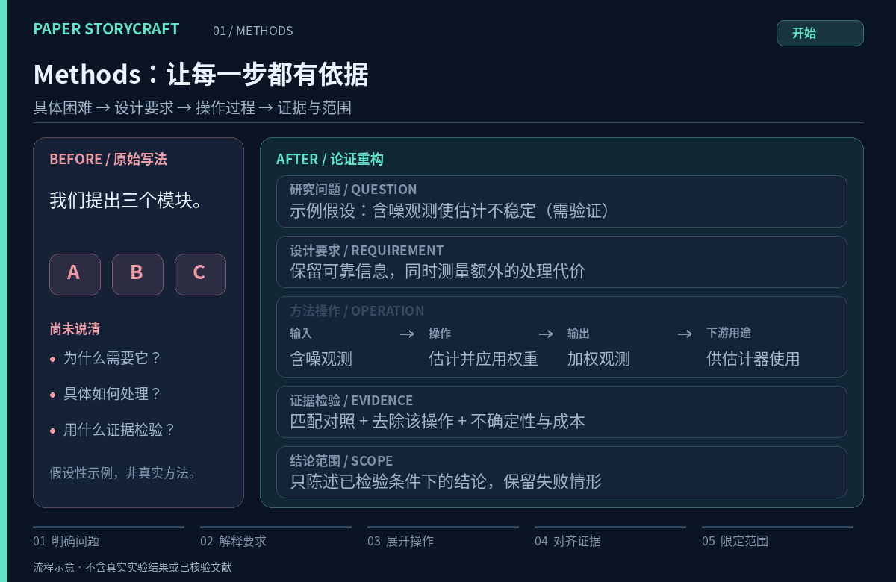

# Paper StoryCraft

### 不止润色句子，让审稿人看懂你的科研贡献。

**13 个科研论文写作与审阅 Skills** · 从研究问题、方法逻辑到实验与引文核验

**[⭐ Star 收藏项目](https://github.com/ChenXiangYpily1234/paper-storycraft-skills)** · [看动态图](#改写前后有什么不同) · **[3 分钟上手](#3-分钟上手)** · [选择 Skill](#根据你的问题选择-skill) · [English](README_EN.md)

如果这个项目能帮你下次少走论文修改的弯路，欢迎点右上角 ⭐ Star，方便以后找回来。

---

你可能做了完整的实验、设计了新方法，但论文读起来仍像**背景堆砌、模块清单、结果流水账**。读者最想知道的三件事反而没有得到回答：

**为什么这个问题值得研究？为什么需要这样的方法？这些实验究竟支持什么结论？**

Paper StoryCraft 提供一套可供 AI 助手读取、执行的科研写作 Skill：**先梳理科学论证，再修改文字表达；既展示真实贡献，也保留证据边界。**

## 改写前后有什么不同？

先看两个动图示例：它们展示的是**写作结构如何变化**，而不是某个模型经过评测后的成绩提升。

### ① Methods：从「列模块」到「有原因的设计」

**普通写法：** “We introduce modules A, B and C to improve robustness.”

**改写方向：** 解释**输入或任务的具体困难**，由此推导出设计要求；再说明每个模块的输入、操作、输出以及下一步如何使用；最后指出哪些实验能够检验核心设计。不是简单地把三个模块写成更长的三个段落。

### ② Related Work：从「引文堆砌」到「可比较的研究路线」

**普通写法：** “Several distillation approaches have been explored (many citations).”

**改写方向：** 根据真正影响研究问题的维度归类，如固定数据和学生生成数据、目标函数或信息访问条件；在**首次介绍已有方法时紧邻名称标注经核实的引用**，在陈述性能与局限性时引用对应证据。模型、benchmark 和数据集分别核对原始出处。

### ③ Experiments：从「成绩播报」到「有边界的结论」

**普通写法：** “Our method significantly outperforms existing baselines.”

**改写方向：** 在 **[实际数据集/版本]、[指标]、[公平比较条件]** 下，报告与 **[实际 baseline]** 的 **[真实差异及不确定性]**；明确它能支持什么结论、不能支持哪些未经测试的情形。

> **这些 GIF 和文字均为示意，不代表真实论文实验、参考文献或模型能力评测。** 实际修改必须以你提供或核验过的资料为依据。

**想在下次写 Introduction、Related Work 或 Experiments 时直接用？[⭐ 给 Paper StoryCraft 一个 Star](https://github.com/ChenXiangYpily1234/paper-storycraft-skills)，再看下面的上手方法。**

## 3 分钟上手

**方式 A：直接用仓库文档指导现有 AI 助手**。适合只想改一节论文、无需安装 Skill 的情况。

~~~bash
git clone https://github.com/ChenXiangYpily1234/paper-storycraft-skills.git
cd paper-storycraft-skills
~~~

将论文片段与下面的指令一起交给**能读取本地文件或仓库链接**的 AI 助手：

~~~text
阅读 PRINCIPLES.md、CITATION_GUIDE.md 和 03-related-work/SKILL.md。
请重构我提供的 Related Work：先找最相关工作，再按研究问题和技术机制组织，
比较各方法真实的训练数据、目标和评估条件。方法名出现时可以紧跟引用，
不要机械地把所有文献放句末。模型、benchmark、数据集分别核验来源。
只使用我提供或你确实核实过的文献；缺失来源列清单，不得编造 BibTeX。
保留原始科学结论与已有引用键，输出修改稿和仍需核查的部分。
~~~

**方式 B：把 13 个目录导出为可扫描的 Skills 集合**，适合支持 Agent Skills 文件夹加载的工具：

~~~bash
python scripts/export_skills.py --output ./my-agent-skills
~~~

脚本会复制 13 个 Skill 目录及其公共指南，保留原有相对引用；之后根据**你所使用工具的官方文档**，把生成的目录配置为 Skill 搜索路径。**它不会自动安装到 ChatGPT、Claude 或任何账户，也不会修改其他工具设置。** 若只打算使用一个 Skill，推荐方式 A，避免单独复制后丢失公共指南。

**兼容性提示：** 本次将各 Skill 的 YAML `name` 调整为与目录一致（例如 `05-experiment`），以符合 Agent Skills 的命名规范。若你的工具曾通过旧名称硬编码调用 Skill，请更新名称；原有目录链接保持不变。

### 可以直接复制的任务示例

~~~text
# 先诊断，不重写
阅读 PRINCIPLES.md 和 09-consistency-validation/SKILL.md。
检查这篇论文的 gap、claim–evidence 关系、引用与实验公平性；
按 P0/P1/P2 给出精确位置和修改建议。未经验证的项目标记 NOT CHECKED。
~~~

~~~text
# 实验写作
阅读 05-experiment/SKILL.md。
不要罗列每张表格：为每组实验指出研究问题、对照、指标、主要观察、
可排除和不可排除的解释。保留全部真实数值与统计限定。
~~~

~~~text
# 多章节无损改写
阅读 13-section-revision/SKILL.md。
改写 Methods 与 Experiments，使公式的动机和实验的作用连成一条线；
逐项核对所有 LaTeX 表格、图片路径、caption、label、引用键和数值，
没有证据的地方不补造。报告哪些检查实际执行过。
~~~

## 根据你的问题选择 Skill

**不需要全部运行。** 根据当前痛点选择一个主 Skill；仅在跨章节冲突时引入其他模块。

| 你现在需要解决的问题 | 入口 |
| --- | --- |
| 摘要泛泛而谈、结论没有证据 | [01 · Abstract](01-abstract/SKILL.md) |
| 引言背景多但研究问题迟迟不出现 | [02 · Introduction](02-introduction/SKILL.md) |
| Related Work 成了按作者排列的清单 | [03 · Related Work](03-related-work/SKILL.md) |
| Methods 一上来就是公式/模块，读者不知为何需要 | [04 · Method](04-method/SKILL.md) |
| 实验表格多，却无法对应 claim 和比较条件 | [05 · Experiments](05-experiment/SKILL.md) |
| Discussion 重复 Results，Conclusion 夸大了范围 | [06 · Discussion & Conclusion](06-discussion-conclusion/SKILL.md) |
| 框架图/图注有歧义，或图文不一致 | [07 · Figures](07-figure/SKILL.md) |
| 标题和小标题没有准确提示论文贡献 | [08 · Titles & Headings](08-title-heading/SKILL.md) |
| 投稿前查事实、统计、引用、全稿一致性 | [09 · Consistency Audit](09-consistency-validation/SKILL.md) |
| 制作或修正 LaTeX 科研表格 | [10 · LaTeX Tables](10-latex-table/SKILL.md) |
| 用真实数据制作可复现科研图 | [11 · Research Plots](11-research-plot/SKILL.md) |
| 需要可编辑 PPTX 结构图 | [12 · Editable PPTX Diagrams](12-pptx-visual/SKILL.md) |
| Methods 和 Experiments 要联动重构且不能丢失现有内容 | [13 · Cross-Section Revision](13-section-revision/SKILL.md) |

**怎么组合？** 常见的修稿路径是 **09 诊断 → 02/03 明确定位 → 04/05 重写论证 → 06 收束 → 01 更新摘要 → 09 复核**；这只是可能的依赖顺序，不是固定步骤。图示与表格类 Skill 按需使用。见 [WORKFLOW.md](WORKFLOW.md)。

## 它为什么和通用润色不同？

- **先检查前提，再改写语言：** 不替错误的科学论断寻找漂亮说辞。
- **专名就近解释与引用：** 外部方法、模型、benchmark、数据集来源可追踪；引用不必都堆在句末。见 [CITATION_GUIDE.md](CITATION_GUIDE.md)。
- **把实验当作推理，而非战报：** 要求控制变量、明确统计单位、公平比较和适用边界。
- **审阅与改写分离：** 若只要求审查，不擅自修改论文；已有 LaTeX 内容可按无损修订契约核对。
- **分离“核验过”和“尚未检查”：** 文本一致性、编译成功、原始实验可复现性是不同层次的证据。

总约束在 [PRINCIPLES.md](PRINCIPLES.md)，学科差异见 [STEM_GUIDE.md](STEM_GUIDE.md)，引用规范在 [CITATION_GUIDE.md](CITATION_GUIDE.md)。

## 适用范围与边界

主要适用于数学、计算机、工程、物理、材料、生物、地球与环境科学及其他 STEM 研究；根据理论证明、实验、现场观测、仿真或系统测评采用不同的证据标准。**不预设投稿会议、固定章节数、固定实验数或统一叙事模板。**

它是**Markdown Skill 与工作流指南集合**，并非可自动完成检索、实验或 LaTeX 编译的在线服务。能否加载 Skill、联网核验文献、修改源文件、绘制图像或生成 PPTX，取决于你实际使用的工具及权限。没有原始论文、BibTeX、实验记录或编译环境时，必须报告未验证之处。

## 开发与质量检查

~~~bash
python scripts/check_skills.py
~~~

仓库检查覆盖 Skill 命名/元数据、相对链接、核心指南及 README 入口等**静态约束**。示例场景见 [tests/skill-scenarios.md](tests/skill-scenarios.md)。静态检查不能替代真实模型输出评估、引用真实性核查、原始实验复现或最终 PDF 人工审查。

可参考的设计思路包括 [Anthropic Skills](https://github.com/anthropics/skills)、[Superpowers](https://github.com/obra/superpowers)、[Academic Writing Skills](https://github.com/WenyuChiou/academic-writing-skills)；本项目针对科研论文的**主张—证据—范围**提出独立规则，并非上述项目的官方扩展或性能验证。

## 关注更新与参与

如果你也在写论文、做科研，觉得这套审查规则值得持续完善，欢迎 [**⭐ Star 本仓库**](https://github.com/ChenXiangYpily1234/paper-storycraft-skills)。Star 能让你之后方便找到它；问题反馈和失败案例请通过 Issues 提交。

## 参与与许可

欢迎通过 [Issues](https://github.com/ChenXiangYpily1234/paper-storycraft-skills/issues) 报告错误规则、模糊步骤和可复现的失败案例。请勿上传未获授权的未发表论文或保密实验数据。

项目采用 [MIT License](LICENSE)。相关项目的独立致谢见 [ACKNOWLEDGEMENTS.md](ACKNOWLEDGEMENTS.md)。

**一条原则：可以重写论证的表达，不能重写事实。**
