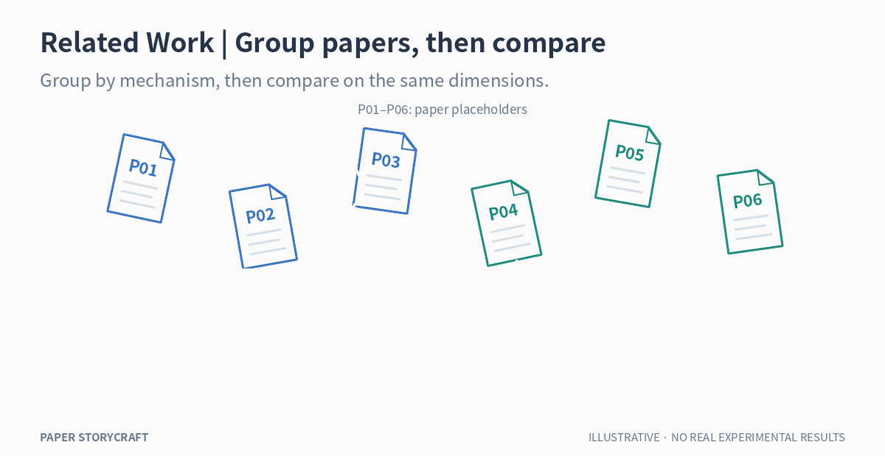
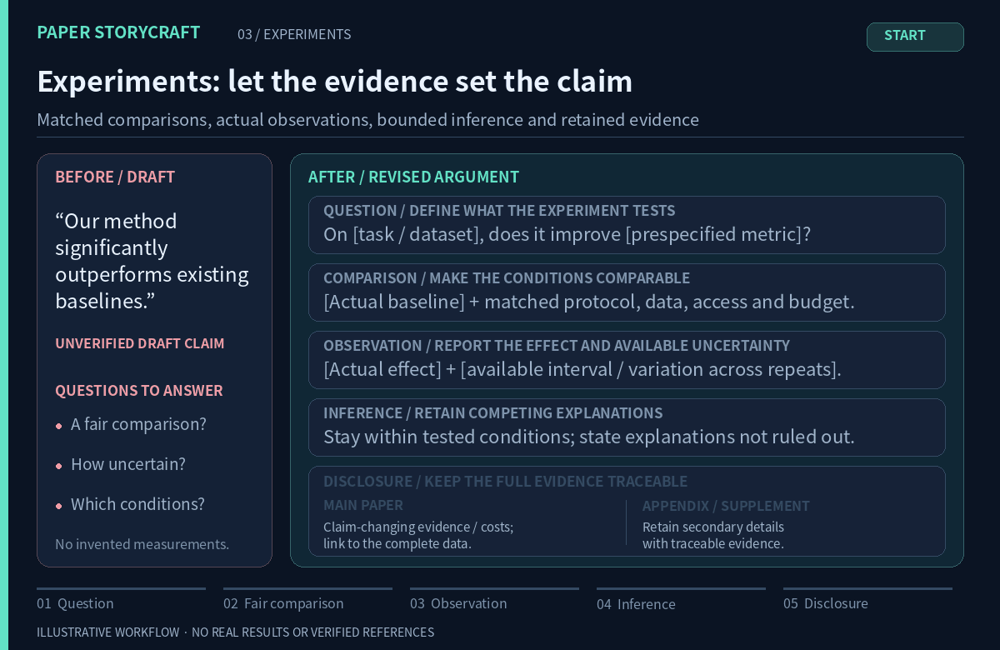

# Paper StoryCraft

### Great research deserves a sharper scientific story.

**13 evidence-first STEM writing & review Skills** · Clear contribution · Fair comparisons · Verified sources

**[⭐ Star this repository](https://github.com/ChenXiangYpily1234/paper-storycraft-skills)** · [Animated examples](#what-changes-in-a-revision) · **[Quick start](#quick-start)** · [Choose a Skill](#choose-a-skill) · [简体中文](README.md)

---

You may have built a genuine method and run extensive experiments, yet your paper can still read like **background notes, a module inventory, and a list of scores**.

Reviewers need clear answers to three questions: **Why this problem? Why this design? What do these experiments establish?**

Paper StoryCraft gives AI assistants an actionable set of research-writing Skills: **clarify the scientific argument before polishing the prose**, without inventing evidence or hiding relevant limitations.

## What changes in a revision?

Three **bright line animations** make the revision steps visible: modules move into place, papers form groups, and comparison conditions align. Each includes a complete static view for reading at your own pace.

### ① Research argument: from module lists to an evidence chain

[View the complete static example](assets/demo-argument-en.png)

**Before:** “We introduce modules A, B and C to improve robustness.”

**Better approach:** Describe the **specific input or task difficulty**, derive a design requirement, and explain each essential step through **input → operation → output → downstream use**. Connect the design to controls, metrics and uncertainty that could test it. Keep design intent distinct from established properties, and limit conclusions to the conditions supported by evidence.

### ② Related Work: from paper lists to a mechanism map

[View the complete static example](assets/demo-related-work-en.png)

**Before:** “Several distillation approaches have been explored (many citations).”

**Better approach:** Group studies by distinctions relevant to the research question, then compare on **shared fields** such as training-data source, objective, information access, evaluation protocol and resource budget. Represent the **strongest prior counterexample** fairly; narrow the contribution if existing work already covers the claimed gap. A difference awaiting verification does not establish that no prior work exists. Method/model/benchmark/dataset attribution remains governed by [CITATION_GUIDE.md](CITATION_GUIDE.md).

### ③ Experiments: from score announcements to defensible claims

[View the complete static example](assets/demo-experiments-en.png)

**Before:** “Our method significantly outperforms existing baselines.”

**Better approach:** On **[actual dataset/version]** with **[metric and statistical unit]** under **[fair comparison conditions]**, report **[verified difference and available uncertainty]** versus **[actual baseline]**. Disclose whether information access, tuning and compute budgets are comparable. State the supported scope and unresolved rival explanations; mark missing statistical information for verification instead of inventing significance. **Failed controls, unfavorable results and costs that change the core claim belong in the main text**, with a pointer to the complete evidence.

> **The GIFs, static images and text examples are illustrative**, not genuine experimental findings, verified references or behavioral benchmarks. Actual revisions depend on supplied or independently checked manuscript evidence.

**Want to see whether the rules help your manuscript?** Try the copy-ready prompt on one real paragraph rather than relying on the illustration.

## Why not simply copy Nature-writing or anti-defensive rules?

**Strength first, with accountable supplementary evidence.** Inspired by [nature-skills](https://github.com/Yuan1z0825/nature-skills) and [anti-defensive-writing-Skill](https://github.com/Adkid-Zephyr/anti-defensive-writing-Skill), Paper StoryCraft keeps the main text centered on what the evidence establishes. **Secondary unfavorable metrics, extra baselines, exploratory analyses and detailed seed results may live in appendices or submitted supplements** rather than dominating the narrative. Results that change the headline conclusion must still be disclosed briefly in the main paper and linked to the full evidence. Never conceal a primary endpoint or silently switch metrics. See [EDITORIAL_PLAYBOOK.md](EDITORIAL_PLAYBOOK.md).

## Quick start

**Fastest path: copy the [English quick-start prompt](prompts/quick-start-en.md)** and supply your manuscript excerpt and actual evidence to your assistant. No installation needed to test the rules. [中文版](prompts/quick-start-zh.md).

**Option A — No install: use the files as guidance.** Give your manuscript excerpt and the linked documents to an assistant that can read the repository; clone locally only if direct GitHub access is unavailable.

~~~bash
git clone https://github.com/ChenXiangYpily1234/paper-storycraft-skills.git
cd paper-storycraft-skills
~~~

Provide your manuscript excerpt and the following prompt to an AI assistant **that can actually read local files or repository URLs**:

~~~text
Read PRINCIPLES.md, CITATION_GUIDE.md and 03-related-work/SKILL.md.
Rewrite my Related Work by grouping verified literature by research question
and technical mechanism instead of listing papers in chronological order.
Compare actual objectives, training data and evaluation conditions.
Cite methods next to their names when that best conveys attribution.
Verify sources for models, benchmarks and datasets separately.
Use only literature I provide or you have independently checked.
List unresolved sources; do not invent BibTeX.
Preserve supported conclusions and existing valid citation keys.
Prioritize the strongest verified contribution; secondary unfavorable detail can be placed in authorized supplements, while claim-changing counterevidence remains disclosed in the main text.
Return the revision and all remaining verification gaps.
~~~

**Option B — Export a Skill collection** for a compatible agent that scans Skill folders. From the repository root:

~~~bash
python -m pip install -r requirements-dev.txt
python scripts/export_skills.py --output ./my-agent-skills
~~~

The script copies the 13 Skill directories **with their shared guides and license**, keeping cross-file links intact. Configure the output as a Skill search directory **according to your particular agent's documentation**. It does not install anything into accounts or change agent settings. For one-off writing help, Option A avoids the problems of copying a single SKILL.md without its dependencies.

**Migration note:** Skill YAML `name` fields now match their folder names (for example, `05-experiment`) to follow the Agent Skills naming specification. If you previously configured old Skill names directly, update those references; directory paths are unchanged.

### Copyable requests

~~~text
# Audit only — don't rewrite
Read PRINCIPLES.md and 09-consistency-validation/SKILL.md.
Audit the paper's research gap, claim–evidence links, citations,
fairness of comparisons, and consistency. Give section locations and
P0/P1/P2 priorities. Mark unavailable checks NOT CHECKED.
~~~

~~~text
# Experiments
Read 05-experiment/SKILL.md. For each experiment, identify the research
question, comparator, metric, key observation and rival explanations.
Retain actual numbers, uncertainty and limitations; don't narrate tables cell by cell.
~~~

~~~text
# Lossless cross-section edit
Read 13-section-revision/SKILL.md. Rewrite Methods and Experiments as one
scientific argument while preserving every LaTeX table, figure path,
caption, label, equation, citation key and result. Inventory what changed
and separate source/PDF/raw-experiment verification statuses.
~~~

## Choose a Skill

**Do not activate all 13 for every task.** Pick the nearest entry point. Combine only where the work genuinely spans sections.

| Problem | Skill |
| --- | --- |
| Abstract is generic or oversells results | [01 · Abstract](01-abstract/SKILL.md) |
| Introduction never reaches a precise question | [02 · Introduction](02-introduction/SKILL.md) |
| Related Work is a bibliography in prose | [03 · Related Work](03-related-work/SKILL.md) |
| Methods lists modules and formulas without rationale | [04 · Method](04-method/SKILL.md) |
| Experiments fail to link claims, controls and metrics | [05 · Experiments](05-experiment/SKILL.md) |
| Discussion repeats results; conclusion exceeds evidence | [06 · Discussion & Conclusion](06-discussion-conclusion/SKILL.md) |
| Scientific diagram or caption is unclear or misleading | [07 · Figures](07-figure/SKILL.md) |
| Titles and headings promise the wrong contribution | [08 · Titles & Headings](08-title-heading/SKILL.md) |
| Paper needs a submission-readiness integrity audit | [09 · Consistency Audit](09-consistency-validation/SKILL.md) |
| LaTeX table needs accurate scientific formatting | [10 · LaTeX Tables](10-latex-table/SKILL.md) |
| Chart needs authentic data and reproducible source | [11 · Research Plots](11-research-plot/SKILL.md) |
| Diagram must be editable in PowerPoint | [12 · Editable PPTX Diagrams](12-pptx-visual/SKILL.md) |
| Adjacent sections need a coordinated lossless rewrite | [13 · Cross-Section Revision](13-section-revision/SKILL.md) |

An optional revision path is **09 diagnose → 02/03 position → 04/05 build argument → 06 interpret → 01 refresh abstract → 09 verify**. This is an example dependency, **not a mandated section order**. See [WORKFLOW.md](WORKFLOW.md).

## Beyond ordinary proofreading

- **Verify the premise before polishing:** reject unsupported claims rather than giving them more confident wording.
- **Explain and cite named entities near first use:** methods, models, benchmarks and datasets have distinct provenance. Citations do not have to sit at sentence endings; see [CITATION_GUIDE.md](CITATION_GUIDE.md).
- **Treat experiments as inference:** check matched protocols, statistical units, uncertainty and alternatives.
- **Keep review separate from editing:** review-only requests do not authorize modifying source files; lossless LaTeX revisions require an artifact inventory.
- **Separate what was checked:** internal textual consistency, successful PDF compilation and empirical reproducibility are different guarantees.

Global principles: [PRINCIPLES.md](PRINCIPLES.md). Consult [STEM_GUIDE.md](STEM_GUIDE.md), [CITATION_GUIDE.md](CITATION_GUIDE.md), and the [EDITORIAL_PLAYBOOK.md](EDITORIAL_PLAYBOOK.md) only as the task requires.

## Scope and limits

Designed for mathematics, computer science, engineering, physical and life sciences, materials, earth/environmental science and other STEM work. Choose proof, experiment, observation, simulation or system validation standards as appropriate. **No default venue, page limit, section count or experiment count is imposed.**

This is a collection of **Markdown Skills and workflows**, not a hosted literature search, experimental platform or LaTeX service. Whether an assistant can load Skills, search scholarly sources, edit source files, render plots or create an editable PPTX depends on its own tools and permissions. Missing source papers, BibTeX, experiment logs or compilation assets must be reported as unverified.

## Development and validation

From the repository root:

~~~bash
python -m pip install -r requirements-dev.txt
python -m unittest discover -s tests -p 'test_*.py' -v
python scripts/check_skills.py
~~~

Repository checks cover Skill naming and YAML frontmatter, execution-contract headings, local file links, shared guides and README entry points. They also check the formats and matching dimensions of all six GIF/PNG pairs, GIF file sizes and decoding of every frame. Unit tests exercise metadata and link parsing, rejection of dependencies outside the collection, and export behavior: preserving links and the license, protecting existing targets, and avoiding partial exports on failure.

These checks validate **repository files and export tooling**. They do not verify remote links, heading fragments or bibliographic accuracy, and cannot replace model-output evaluation, experimental reproduction or manual review of final PDFs. See [tests/skill-scenarios.md](tests/skill-scenarios.md) for scenarios to use in human or model evaluation.

### Regenerate the README examples

The [rendering script](scripts/render_readme_demos.py) produces three bilingual GIF examples and matching complete static PNGs. It uses **Noto Sans CJK SC** and **fontconfig** by default. Install those system dependencies, then run:

~~~bash
python -m pip install -r requirements-dev.txt
python scripts/render_readme_demos.py
~~~

To use custom fonts, set `STORYCRAFT_FONT_REGULAR` and `STORYCRAFT_FONT_BOLD` to regular and bold font file paths with both Chinese and English glyph coverage.

Design references include [Anthropic Skills](https://github.com/anthropics/skills), [Superpowers](https://github.com/obra/superpowers), and [Academic Writing Skills](https://github.com/WenyuChiou/academic-writing-skills). This project is an independent set of research-writing rules, not an official extension or validated benchmark of those projects.

## Contribute and license

Report incorrect rules, vague procedures and reproducible failure cases via [Issues](https://github.com/ChenXiangYpily1234/paper-storycraft-skills/issues). Do not publish unpublished or confidential research material without permission.

Released under the [MIT License](LICENSE). Independent project acknowledgements: [ACKNOWLEDGEMENTS.md](ACKNOWLEDGEMENTS.md).

**Rewrite the argument, not the facts.**
