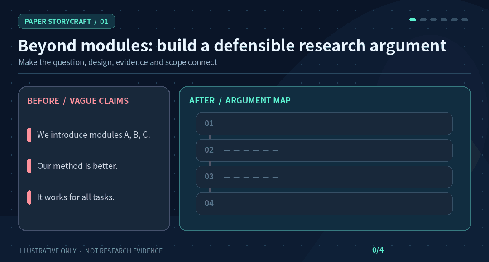
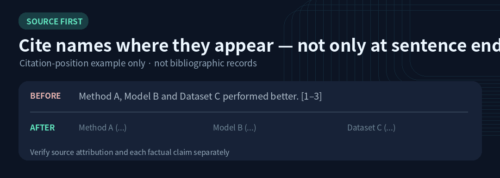

# Paper StoryCraft

### Good research deserves a clearer paper.

**Turn research questions, methods, experimental results, and citations into an argument reviewers can actually follow.**

13 composable STEM writing & review Skills · Beyond grammar polishing · Evidence-first

[**⭐ Star this repo**](https://github.com/ChenXiangYpily1234/paper-storycraft-skills) · [**⚡ Try it in 3 minutes**](#quick-start) · [**🎬 Watch the examples**](#what-changes-in-a-revision) · [简体中文](README.md)

 

---

**Your paper may not need another experiment. It may need a stronger explanation of the evidence you already have.** A Methods section can contain many modules without explaining their purpose; Related Work can cite dozens of studies without clarifying the difference; an experiment section can be full of tables without testing the headline claim.

Paper StoryCraft provides **actionable Skills for writing, revising, and reviewing**: question assumptions before polishing, connect design decisions to needs, attach results to testable claims, and give models, benchmarks, and datasets verifiable provenance.

**If this could help your next revision, [give the project a Star](https://github.com/ChenXiangYpily1234/paper-storycraft-skills)** so it's easy to find again.

## What changes in a revision?

### Animated example ① — From a list of claims to a defensible argument

The goal is **not more confident wording**. The animation walks through four information slots that a reviewer needs: **question → design → evidence → scope**. Bracketed content represents **missing information to be filled with authentic sources and results**, not reported experiments. Static alternative: “We introduce A, B, and C and improve performance” must explain *what problem motivates the design, why these stages exist, which comparison tests them, and where the conclusion holds*.

### Animated example ② — Put citations where the attribution belongs

A method, a model, and a dataset may require **different primary sources**, placed near their first meaningful mentions. A distinct performance claim needs a source that actually supports that claim. Labels such as “[method source]” are **not bibliographic records**. See [CITATION_GUIDE.md](CITATION_GUIDE.md).

### Why it goes beyond proofreading

| Typical problem | What the Skills check |
| --- | --- |
| “Existing work has obvious limitations” without support | Identify the closest work and make the research gap **specific and verifiable** |
| Methods lists A, B, and C without rationale | Trace **need → input → operation → output → downstream use** |
| Every table gets a generic “better” claim | Match **claim → baseline → data/budget → metric → result → alternative explanation** |
| Citations sit at sentence ends; benchmarks go unattributed | Verify methods, models, benchmarks, and datasets separately; mark unknown sources unresolved |

> **These are writing demonstrations, not evidence of real research gains or an independently evaluated improvement in writing quality.** Without manuscript evidence, the Skills cannot produce valid empirical claims.

**Want to test this on your paper?** Go to [Quick start](#quick-start) and try it on one Related Work paragraph.

## Quick start

**Option A — Use the guidance files directly.** Best for revising a specific passage without installing a Skill.

~~~bash
git clone https://github.com/ChenXiangYpily1234/paper-storycraft-skills.git
cd paper-storycraft-skills
~~~

Provide your manuscript excerpt and the following prompt to an AI assistant **that can actually read local files or repository URLs**:

~~~text
Read PRINCIPLES.md, CITATION_GUIDE.md and 03-related-work/SKILL.md.
Rewrite my Related Work by grouping verified literature by research question
and technical mechanism instead of listing papers in chronological order.
Compare actual objectives, training data and evaluation conditions.
Cite methods next to their names when that best conveys attribution.
Verify sources for models, benchmarks and datasets separately.
Use only literature I provide or you have independently checked.
List unresolved sources; do not invent BibTeX.
Preserve supported conclusions and existing valid citation keys.
Return the revision and all remaining verification gaps.
~~~

**Option B — Export a Skill collection** for a compatible agent that scans Skill folders:

~~~bash
python scripts/export_skills.py --output ./my-agent-skills
~~~

The script copies the 13 Skill directories **and their shared guides**, keeping cross-file links intact. Configure the output as a Skill search directory **according to your particular agent's documentation**. It does not install anything into accounts or change agent settings. For one-off writing help, Option A avoids the problems of copying a single SKILL.md without its dependencies.

**Migration note:** Skill YAML `name` fields now match their folder names (for example, `05-experiment`) to follow the Agent Skills naming specification. If you previously configured old Skill names directly, update those references; directory paths are unchanged.

### Copyable requests

~~~text
# Audit only — don't rewrite
Read PRINCIPLES.md and 09-consistency-validation/SKILL.md.
Audit the paper's research gap, claim–evidence links, citations,
fairness of comparisons, and consistency. Give section locations and
P0/P1/P2 priorities. Mark unavailable checks NOT CHECKED.
~~~

~~~text
# Experiments
Read 05-experiment/SKILL.md. For each experiment, identify the research
question, comparator, metric, key observation and rival explanations.
Retain actual numbers, uncertainty and limitations; don't narrate tables cell by cell.
~~~

~~~text
# Lossless cross-section edit
Read 13-section-revision/SKILL.md. Rewrite Methods and Experiments as one
scientific argument while preserving every LaTeX table, figure path,
caption, label, equation, citation key and result. Inventory what changed
and separate source/PDF/raw-experiment verification statuses.
~~~

## Choose a Skill

**Do not activate all 13 for every task.** Pick the nearest entry point. Combine only where the work genuinely spans sections.

| Problem | Skill |
| --- | --- |
| Abstract is generic or oversells results | [01 · Abstract](01-abstract/SKILL.md) |
| Introduction never reaches a precise question | [02 · Introduction](02-introduction/SKILL.md) |
| Related Work is a bibliography in prose | [03 · Related Work](03-related-work/SKILL.md) |
| Methods lists modules and formulas without rationale | [04 · Method](04-method/SKILL.md) |
| Experiments fail to link claims, controls and metrics | [05 · Experiments](05-experiment/SKILL.md) |
| Discussion repeats results; conclusion exceeds evidence | [06 · Discussion & Conclusion](06-discussion-conclusion/SKILL.md) |
| Scientific diagram or caption is unclear or misleading | [07 · Figures](07-figure/SKILL.md) |
| Titles and headings promise the wrong contribution | [08 · Titles & Headings](08-title-heading/SKILL.md) |
| Paper needs a submission-readiness integrity audit | [09 · Consistency Audit](09-consistency-validation/SKILL.md) |
| LaTeX table needs accurate scientific formatting | [10 · LaTeX Tables](10-latex-table/SKILL.md) |
| Chart needs authentic data and reproducible source | [11 · Research Plots](11-research-plot/SKILL.md) |
| Diagram must be editable in PowerPoint | [12 · Editable PPTX Diagrams](12-pptx-visual/SKILL.md) |
| Adjacent sections need a coordinated lossless rewrite | [13 · Cross-Section Revision](13-section-revision/SKILL.md) |

An optional revision path is **09 diagnose → 02/03 position → 04/05 build argument → 06 interpret → 01 refresh abstract → 09 verify**. This is an example dependency, **not a mandated section order**. See [WORKFLOW.md](WORKFLOW.md).

## Beyond ordinary proofreading

- **Verify the premise before polishing:** reject unsupported claims rather than giving them more confident wording.
- **Explain and cite named entities near first use:** methods, models, benchmarks and datasets have distinct provenance. Citations do not have to sit at sentence endings; see [CITATION_GUIDE.md](CITATION_GUIDE.md).
- **Treat experiments as inference:** check matched protocols, statistical units, uncertainty and alternatives.
- **Keep review separate from editing:** review-only requests do not authorize modifying source files; lossless LaTeX revisions require an artifact inventory.
- **Separate what was checked:** internal textual consistency, successful PDF compilation and empirical reproducibility are different guarantees.

Global principles: [PRINCIPLES.md](PRINCIPLES.md). Discipline-specific evidence: [STEM_GUIDE.md](STEM_GUIDE.md). Citation provenance: [CITATION_GUIDE.md](CITATION_GUIDE.md).

## Scope and limits

Designed for mathematics, computer science, engineering, physical and life sciences, materials, earth/environmental science and other STEM work. Choose proof, experiment, observation, simulation or system validation standards as appropriate. **No default venue, page limit, section count or experiment count is imposed.**

This is a collection of **Markdown Skills and workflows**, not a hosted literature search, experimental platform or LaTeX service. Whether an assistant can load Skills, search scholarly sources, edit source files, render plots or create an editable PPTX depends on its own tools and permissions. Missing source papers, BibTeX, experiment logs or compilation assets must be reported as unverified.

## Development and validation

~~~bash
python scripts/check_skills.py
~~~

Checks cover **static contracts** such as Skill naming/frontmatter, links, shared documentation and README entry points. See [tests/skill-scenarios.md](tests/skill-scenarios.md) for realistic behavioral scenarios. Passing static checks is **not** evidence of model behavior quality, bibliographic accuracy, experimental reproducibility or rendered PDF correctness.

Design references include [Anthropic Skills](https://github.com/anthropics/skills), [Superpowers](https://github.com/obra/superpowers), and [Academic Writing Skills](https://github.com/WenyuChiou/academic-writing-skills). This project is an independent set of research-writing rules, not an official extension or validated benchmark of those projects.

## Follow updates

If these research-writing checks would be useful in a future revision, [**⭐ Star the repository**](https://github.com/ChenXiangYpily1234/paper-storycraft-skills) to keep it handy. Concrete failures and suggestions are best shared in Issues.

## Contribute and license

Report incorrect rules, vague procedures and reproducible failure cases via [Issues](https://github.com/ChenXiangYpily1234/paper-storycraft-skills/issues). Do not publish unpublished or confidential research material without permission.

Released under the [MIT License](LICENSE). Independent project acknowledgements: [ACKNOWLEDGEMENTS.md](ACKNOWLEDGEMENTS.md).

**Rewrite the argument, not the facts.**
